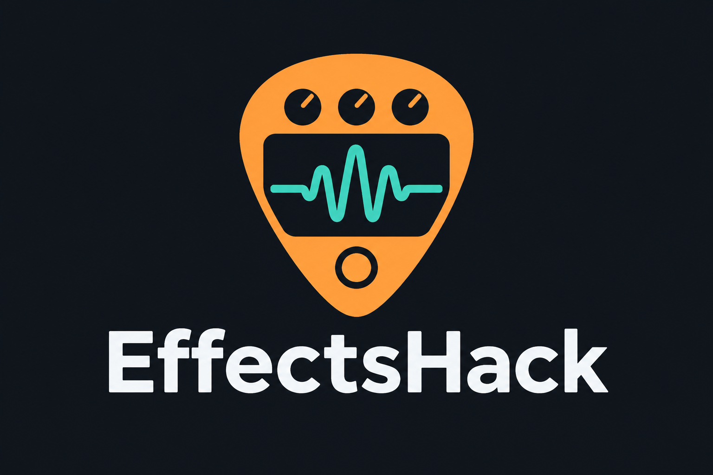

<p align="center">
  
</p>

# EffectHack

**Pick a song. Generate a guitar tone. Plug in and play.**

EffectHack is a standalone guitar effects processor built with C++20 and JUCE. Give it a YouTube link, an audio reference, or an artist and song name; Gemini proposes a tone using examples rendered by the actual processor. You can play through the result, edit every effect, and compare two versions of your rack.

Built and tested on **Linux**. Windows is a future port; it has not been verified.

[Watch the 28-second demo](documentation/effectshack-demo.mp4) · [Playing guide](documentation/USAGE.md) · [Code architecture](documentation/ARCHITECTURE.md) · [Developer guide](documentation/DEVELOPMENT.md)

## What you can do

| Use case | Workflow |
| --- | --- |
| Find a starting tone for a song | Paste a YouTube link in **Song…**, choose the guitar part, and click **Match tone**. |
| Match a particular intro or solo | Select **Intro** or **Lead** and enter the section's **From / To** times. |
| Compare tones without playing repeatedly | **Record** a dry phrase, click **Finish**, and audition the loop through different settings. |
| Try a brighter or heavier variation | Copy **A → B**, edit B, and press **X** to compare. |
| Practice without a guitar or interface | Choose **Test riff** or load a dry guitar audio file in **Input & audio…**. |
| Build your own rig | Reorder nine effects, load a cabinet impulse response, and save a preset. |

The rack includes **noise gate → compressor → distortion → amp → cabinet → EQ → chorus → delay → reverb**. Stages can be moved and bypassed individually. The amp has generic clean, crunch, and high-gain voices. Stereo processing is preserved when you reorder effects.

## Build and run

You need a C++20 compiler, CMake 3.22+, libcurl 7.85+ development files, and the Linux development libraries for ALSA, FreeType/Fontconfig, X11/Xrandr/Xinerama/Xcursor, and OpenGL. CMake downloads a pinned JUCE revision on the first configure. WebKit is not required.

```sh
cmake -S . -B build -DCMAKE_BUILD_TYPE=Release
cmake --build build --parallel 2
./build/EffectHack_artefacts/Release/EffectHack
```

For a quick offline test, open **Input & audio…**, choose **Test riff** and an output device, then start playback. The rack, factory presets, tuner, A/B slots, and phrase recorder work without an API key.

### Enable song matching

Copy the example configuration, then put your Gemini API key in `.env`:

```sh
cp .env.example .env
```

```dotenv
GEMINI_API_KEY=your_api_key_here
GEMINI_MODEL=gemini-3.5-flash-lite
```

The model above is the repository's configured default. You can change it to a model available to your project that supports the required media and structured output. Environment variables override `.env`. Keep your real key out of version control.

Open **Song…**, paste a link, leave **Custom** and **Keep master** enabled, and click **Match tone**. The generated tone replaces the active A/B slot after validation; **Revert** restores the previous tone. Use **Save as…** to keep it as a named preset.

## Example: match a song, then make it yours

1. Connect a guitar to your interface's instrument input. Use wired headphones for responsive monitoring.
2. Open **Input & audio…**, choose **Guitar input**, configure the devices, and select the guitar's channel.
3. Start audio and adjust the interface gain so strong strokes stay below clipping.
4. Open **Song…** and paste `https://www.youtube.com/watch?v=1-3efFGEnr8`.
5. Choose the intended part. For an opening section, select **Intro**, **From `0:00`**, **To `0:25`**. Leave both times empty for automatic selection.
6. Click **Match tone**. Play through the generated rack.
7. Press **R**, record a short phrase, then press **R** again to loop it. Copy A to B, select B, and adjust amp gain or EQ. Press **X** to compare.

A reference with a clear guitar part gives the model more useful evidence than a dense mix. For a local recording, choose **Audio reference** in the Song dialog. This is separate from **Audio file** input, which plays a file through the effects.

## How tone matching works

1. **Read the reference.** Use YouTube media, a selected audio-file section, or a name-based estimate.
2. **Compare real processor examples.** In Custom mode, Gemini receives nine rendered reference tones made by this app.
3. **Compile a bounded plan.** Local code converts a base tone and constrained edits into a complete rack. Effect order and amp voice come from the selected example.
4. **Listen again.** For audio references, a second Gemini pass can refine the rendered candidate. If review is unavailable, the first valid match can be retained.
5. **Check and apply.** Local rendering checks headroom; the app fades down, applies the prepared rack, and fades back up.

This produces a practical approximation, not a reconstruction of studio equipment or a measured match percentage. **Keep master** preserves your input trim and listening volume. Level balancing happens during preparation; there is no continuous automatic volume adjustment while playing.

YouTube URLs and selected local reference audio are sent to Gemini, along with synthetic processor examples. Your live guitar and recorded practice phrase are not uploaded by the matcher.

## Everyday controls

| Key | Action |
| --- | --- |
| **Space** | Play / pause |
| **R** | Record / finish a dry phrase |
| **L** | Switch between the recorded phrase and the original input |
| **1 / 2**, **X** | Select A / B, or switch between them |
| **Shift+X** | Copy the current tone to the other slot |
| **B** | Bypass the whole rack |
| **M** | Mute |
| **T** | Toggle tuner |
| **Home** | Restart a file, riff, or recorded phrase |

Shortcuts are inactive while editing text or using modal dialogs. Input and Output remain shared when switching A/B slots. The app remembers your setup on normal exit and starts with playback paused. **Recorded phrases are temporary: keep the app open until you are finished with the take.**

## Current scope

- Standalone desktop app; no VST/AU plugin build or automatic mid-song preset switching.
- One overall tone per requested part. No note scoring, MIDI/Guitar Pro analysis, or isolated guitar extraction.
- Generic amp and built-in cabinet approximation, with support for custom cabinet IRs.
- Song matching needs network access and your Gemini credentials; the audio processor runs locally.

## Development

```sh
ctest --test-dir build --output-on-failure
```

Tests use synthetic audio and fake API responses; no live Gemini request or guitar is required. See the [developer guide](documentation/DEVELOPMENT.md) for focused tests, the command-line matcher, and how to add an effect. See [architecture](documentation/ARCHITECTURE.md) for threading, preset formats, and the tone-generation pipeline.
