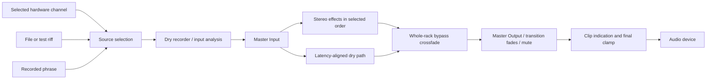
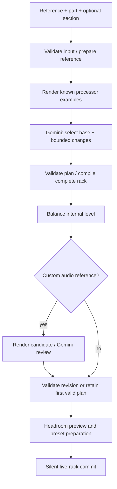

# Code architecture

[Project overview](../README.md) · [Developer workflow](DEVELOPMENT.md)

## Start here

| Responsibility | Main files |
| --- | --- |
| App/window lifetime | [`main.cpp`](../main.cpp) |
| Audio callback, routing, fades, transport | [`AudioEngine.h`](../AudioEngine.h), [`AudioEngine.cpp`](../AudioEngine.cpp) |
| Effect IDs, control names/ranges, order | [`RackDefinition.h`](../RackDefinition.h) |
| Effect implementation and parameters | [`effects/`](../effects/) — one header/source pair per effect |
| Preset snapshots, validation, IR preparation | [`PresetManager.h`](../PresetManager.h), [`PresetManager.cpp`](../PresetManager.cpp) |
| Factory tones | [`FactoryPresets.cpp`](../FactoryPresets.cpp) |
| Matching orchestration and offline renders | [`ToneMatching.cpp`](../ToneMatching.cpp) |
| Gemini plan schema, validation, deterministic compilation | [`ToneAnalysis.cpp`](../ToneAnalysis.cpp) |
| Final full-rack validation and preview | [`GeneratedRack.cpp`](../GeneratedRack.cpp), [`GeneratedTonePreparation.cpp`](../GeneratedTonePreparation.cpp) |
| Reference media and network boundary | [`ReferenceAudio.cpp`](../ReferenceAudio.cpp), [`YouTubeMetadata.cpp`](../YouTubeMetadata.cpp), [`HttpClient.cpp`](../HttpClient.cpp), [`ApiConfig.cpp`](../ApiConfig.cpp) |
| A/B state and persistence | [`ToneSlots.cpp`](../ToneSlots.cpp), [`SessionState.cpp`](../SessionState.cpp) |
| File/riff playback and temporary phrase recording | [`VirtualInput.cpp`](../VirtualInput.cpp), [`DryPhraseRecorder.cpp`](../DryPhraseRecorder.cpp) |
| Input metering, pitch worker, callback metrics | [`InputMonitor.cpp`](../InputMonitor.cpp), [`Tuner.cpp`](../Tuner.cpp), [`RigStatus.cpp`](../RigStatus.cpp) |
| UI components | [`MainComponent.h`](../MainComponent.h), [`SongPresetPanel.cpp`](../SongPresetPanel.cpp), [`RigTools.cpp`](../RigTools.cpp), [`MetricMeter.cpp`](../MetricMeter.cpp), [`DryPhrasePanel.cpp`](../DryPhrasePanel.cpp) |

`MainComponent.cpp` binds controls and devices. Its companion translation units separate song transactions, session restoration, A/B slots, keyboard input, and phrase recording. `GeminiRecommender.*` retains shared recommendation types and the earlier metadata-based API; the current Song dialog calls `matchSongTone()`.

## Signal path

One mono source enters the engine. File input is downmixed before processing. Input trim is applied once, then duplicated into two channels. Distortion, amp, cabinet, and EQ use `ChannelWiseRackStage`: the left and right processors share atomic controls but retain independent DSP histories. Gate and compressor use linked stereo detectors; chorus, delay, and reverb process stereo directly. Only a device with one active output receives a final mono fold-down.

`RackStageChain` holds non-owning pointers to stages owned by `AudioEngine`. The desired order is distinct from `activeStages`, the fixed-size snapshot used by the callback. An order change fades down, changes the active snapshot, resets signal history, and fades back up.

Whole-rack bypass does not skip the effect loop: effects keep processing while the audible signal crossfades to a delayed dry path. This preserves latency alignment and avoids restarting effects on return. Mute is independent of playback; Pause stops transport after its fade. At non-looping EOF, the engine can feed silence through spatial effects until they become quiet or reach the tail timeout.

## Thread and ownership rules

| Context | Owns / may do | Must avoid |
| --- | --- | --- |
| Audio callback | Source samples, fixed buffers, effect histories, smoothers, recorder writes, meter publication | File/network operations, UI calls, blocking waits, new buffer allocation |
| Message thread | UI, device configuration, pending transactions, preset identity, A/B selection | Blocking HTTP, media decoding, offline preview rendering |
| Worker jobs | Decode files/IRs, render examples/candidates, HTTP, prepare presets | Direct mutation of a running engine or UI widgets |
| Tuner thread | Consume analysis FIFO, estimate pitch, publish result | Reading live effect buffers or resetting the producer's FIFO |

Atomics support individual scalar controls and published metrics. They do **not** make a whole preset, rack order, clip replacement, or transport mutation atomic. Follow the existing `AudioDeviceManager::getAudioCallbackLock()` boundaries for compound live-engine operations. Preparation happens outside that lock; the commit is short and serialized.

The callback chunks oversized incoming blocks to its prepared capacity. Buffer allocation and sample-rate-dependent preparation happen before processing. Offline renderers own an independent `AudioEngine`, call `prepare()`, and drive its callback without opening a sound device.

Worker callbacks use `juce::Component::SafePointer` and post back with `MessageManager::callAsync`. Request serials and cancellation tokens prevent superseded jobs from publishing stale UI state. A non-null shared atomic cancellation flag is required by the matching/HTTP interfaces. Progress notifications run on the worker and must be marshalled to the message thread.

`InputMonitor` is a single-producer/single-consumer FIFO. The callback publishes dry analysis samples; the tuner consumes them. Generation tags invalidate readings after source/device changes without concurrently resetting FIFO indices. Meter publication is independent from pitch estimation.

## Song matching

`ToneMatchInput` describes source, guitar part, optional time bounds, and Master preferences. The reference paths differ:

- **YouTube:** parse an allowlisted public video URL, fetch optional title/channel metadata, and supply the video URL as Gemini media. The app does not download the video.
- **Audio file:** decode a bounded section on a worker, downmix/resample it, and encode a 16-bit, 16 kHz mono WAV in memory.
- **Artist + song:** use text-based musical knowledge and label the result `Song estimate`.

Custom matching renders nine anchors: six factory presets plus edge of breakup, classic crunch, and pedal-into-clean-amp examples. They use the same synthetic riff, with comparable levels and peak headroom. Factory-selection mode uses the factory catalog and returns an existing preset ID.

Gemini returns a compact plan, not arbitrary engine state. `decodeToneAnalysis()` rejects unknown fields, unsupported base IDs, malformed types, out-of-range values, and unbounded text. `compileTonePlan()` deep-copies the selected anchor and applies bounded changes. It preserves that anchor's stage order and amp voice, sets a conservative gate, limits compression, and emits all controls/bypasses. `juce::var` object copies are shared, so the deep copy is important.

For custom media requests, the second pass receives a rendered candidate along with the reference and examples. A valid revision is compiled and balanced again. An unavailable review can retain the first valid match with a warning; cancellation discards the pending result. A configured-model HTTP 404 permits the code's fallback model; quota/authentication errors do not trigger that retry.

`balanceMatchedTone()` compares internal output level against a clean reference. `prepareGeneratedTone()` then renders a louder synthetic riff plus tails, rejects nonfinite output, and attenuates post-gain amp Level (when preserving Master) or Output. This is a preparation-time check on a reference performance, not live automatic gain control or a guarantee for every input signal.

Changing anchor order or adding nonlinear stages after amp Level requires revisiting the balancing/headroom assumptions. The preserve-Master path checks the supported order and an active amp before applying internal attenuation.

## Applying a tone safely

`MainComponentSong.cpp` implements a transaction shared by generated tones, A/B switches, and Revert:

1. Capture the previous rack and identity on the message thread.
2. Prepare/validate the target and cabinet IR on a worker, or reuse a prepared slot IR.
3. Post the complete result back. Cancelled/failed preparation leaves the current tone intact.
4. Request a fade down through `beginRackUpdate()`.
5. `serviceToneChange()` polls until `rackUpdateIsSilent()` while holding the callback lock, then calls `applyPreset()` and ends the update.
6. Publish the new preset/slot identity and refresh controls only after a successful commit.

With Keep master enabled, current Input/Output values are re-read at commit so edits made during a network request remain the player's settings. A/B uses one engine: switching clears old tails rather than running two racks in parallel.

## Data and persistence

| Object | Contents | Lifetime |
| --- | --- | --- |
| `RackState` | 32 parameter values, bypasses, amp voice, complete stage order, cabinet path | In-memory tone snapshot |
| `Preset` | Stable ID/name plus rack | Factory catalog or user JSON |
| `PreparedPreset` | Rack plus decoded immutable cabinet response or error | Prepared off-thread for commit |
| `ToneSnapshot` | Saved/generated baseline and current edited rack | A/B edit buffer |
| `SessionState` | Rack/slots plus source, file path, devices and tuner preferences | Written on normal close |
| `DryPhrase` | Audio clip and waveform peaks | Memory only; not persisted/uploaded |

Preset format v4 stores order and all current effects. Readers migrate supported older versions and validate the full rack before applying it. Parameter indexing and ranges come from `RackDefinition.h`; update all related schemas/migrations if this changes. Custom IRs are referenced by path, not embedded in JSON.

Linux user data normally lives under `~/.config/EffectHack/`: `Presets/` for user tones and `session.json` for startup state. Use `PresetManager::defaultDirectory()` and `SessionStore::defaultFile()` instead of hard-coded paths in code. Session writes validate first, then replace the destination through a temporary file. A missing custom IR prevents that tone from being restored; an invalid session falls back to defaults.

The dry recorder allocates before recording. The callback copies pre-trim mono samples into bounded storage, publishes completion, and stops at 30 seconds. Finalization trims the buffer, adds short boundary fades, and computes waveform peaks off-thread. Audition changes the source through a fade; self-recording is blocked. Clip ownership remains alive while transport reads it.

## Credentials and external data

`ApiConfig` reads `.env` or environment overrides. Do not log or serialize keys, complete authentication headers, or unredacted request bodies containing reference media. `HttpTransport` is injectable so tests can exercise parsing, failures, review, and cancellation without external calls. Matching uploads the selected reference and synthetic examples; it does not capture or upload live guitar.
